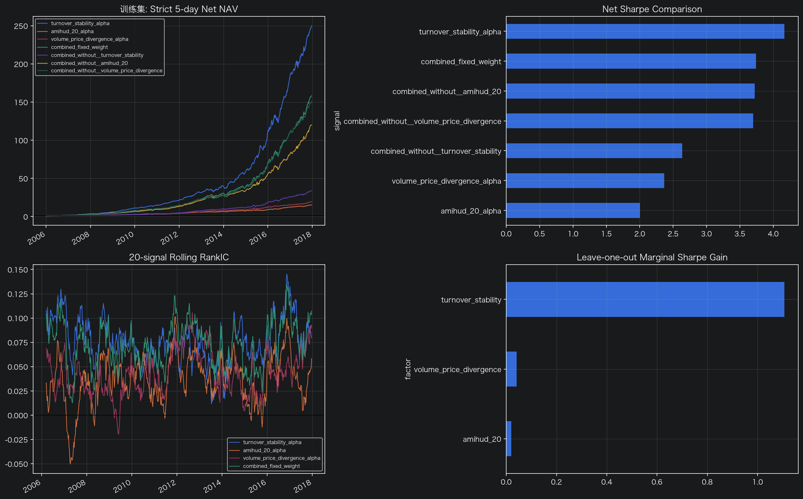
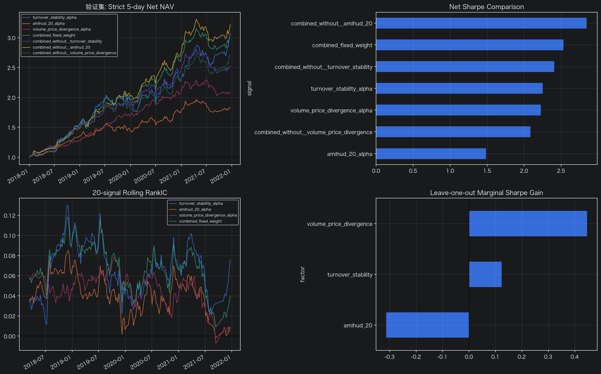

# A 股多因子研究与严格回测

这是一个面向学习与复现的 A 股日频量化研究项目，覆盖“因子构造 → 严格回测 → 样本外验证 → 多因子相关性与组合检验”的完整流程。项目特别强调时间边界、可交易性、交易成本和训练/验证隔离，尽量避免前视偏差与参数泄漏。

> 本仓库仅用于研究和学习，不构成任何投资建议。历史回测和样本外验证结果不代表未来表现。

## 项目内容

- **有效因子研究**：20 日量稳换手率（STR）、20 日 Amihud 非流动性、20 日成交量价背离度。
- **反例记录**：12-1 动量与上影线因子保存在 `Factor/无效因子库/`，用于保留失败探索和研究边界。
- **严格回测引擎**：T 日收盘形成信号，最早 T+1 成交；支持 IC、分组回测、换手、交易成本、缺失收益与完整性审计。
- **样本外验证**：训练期为 2006–2017，验证期为 2018–2021，2022 年以后数据保持为测试集。
- **多因子检验**：两两相关性、固定权重组合、逐因子剔除、训练/验证对比。

## 目录结构

```text
.
├── Back_test/
│   ├── backtest.py                    # 通用严格回测引擎
│   └── 通用因子回测模板.ipynb          # 单因子回测入口
├── Factor/
│   ├── TURNOVER_STABILITY.ipynb       # 量稳换手率
│   ├── AMIHUD_20.ipynb                # Amihud 非流动性
│   ├── VOLUME_PRICE_DIVERGENCE.ipynb  # 成交量价背离
│   └── 无效因子库/                     # 已否定或暂不采用的研究
├── Validation_test/
│   └── validationtest.ipynb           # 样本外验证
├── Correlation_test/
│   └── correlation_test.ipynb         # 多因子检验
├── Data/
│   └── README.md                      # 数据契约与放置方式
└── docs/results/                      # 精选训练/验证结果
```

原始行情、因子 Parquet、中间 CSV、持仓明细和缓存没有纳入仓库。它们体积很大、可以由 Notebook 重新生成，并且通常受数据供应商许可约束。

## 环境准备

建议使用 Python 3.10 或更高版本。

```bash
python3 -m venv .venv
source .venv/bin/activate
python -m pip install --upgrade pip
pip install -r requirements.txt
jupyter lab
```

Windows PowerShell 激活虚拟环境时使用：

```powershell
.venv\Scripts\Activate.ps1
```

## 数据准备

将自己的日行情文件放到：

```text
Data/stocks_daily_04-25.parquet
```

必须字段、单位和代码格式见 [`Data/README.md`](Data/README.md)。仓库不会提供原始行情数据。

## 建议运行顺序

1. 运行 `Factor/` 下的因子 Notebook，先生成训练期因子。
2. 运行 `Back_test/通用因子回测模板.ipynb`，检查完整性审计后再阅读收益结果。
3. 使用相同因子定义生成 2018–2021 验证因子，放入 `Validation_test/data/` 对应目录。
4. 运行 `Validation_test/validationtest.ipynb`，只按预先冻结的门槛评价。
5. 运行 `Correlation_test/correlation_test.ipynb`，比较单因子、固定权重组合及逐因子剔除结果。

Notebook 会自动从当前目录向上寻找项目根目录，也可通过 `QUANT_LEARNING_DIR` 指定仓库绝对路径。其他可调环境变量均记录在相应 Notebook 的“参数/配置”单元中。

## 研究约束

- 因子只使用信号日及以前的数据，`asof_date` 不晚于 `date`。
- 训练、验证和测试时间段彼此隔离。
- 回测至少延迟一个交易日执行，避免同日信号同日成交。
- 持有期与调仓间隔默认相等，避免持有期重叠。
- 交易成本、不可交易股票、缺失收益和成交覆盖率均显式审计。
- 因子已经做过横截面预处理时，不在回测阶段重复中性化。

## 精选结果

下面仅展示已有实验的代表性图表。可复核的汇总 CSV 位于 `docs/results/train/` 与 `docs/results/validation/`。

### 训练期多因子结果（2006–2017）



### 验证期多因子结果（2018–2021）



验证期固定权重组合的历史净夏普为 2.53、年化收益约 34.5%、最大回撤约 -11.2%。这些数字取自当前数据与冻结配置下的研究输出，不能视为可直接实现的实盘收益。

## 已知限制

- 当前仅做规模中性化，未纳入完整行业与 Barra 风格暴露。
- 缺少逐股融券可得性、冲击成本和更细粒度成交数据；多空组合属于研究组合。
- 数据字段和单位与本项目的数据契约强绑定，使用其他供应商数据时需先做字段映射。
- Notebook 适合展示完整研究过程；若用于生产环境，建议将因子计算拆为可测试的 Python 模块。

## 上传前说明

仓库当前没有预设开源许可证。发布前请根据自己的授权意图添加许可证；如果暂时不确定，可以先保持无许可证状态。还应再次确认原始行情数据的供应商条款允许公开哪些派生结果。

